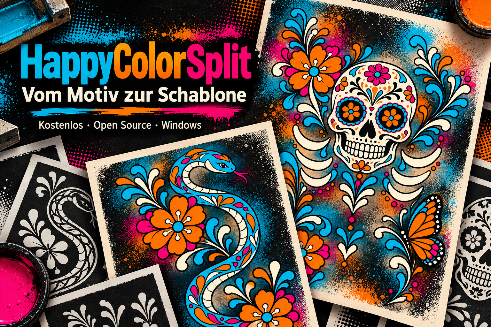
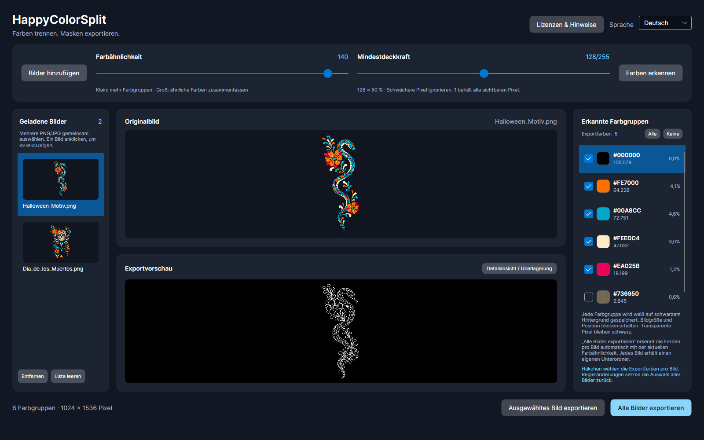
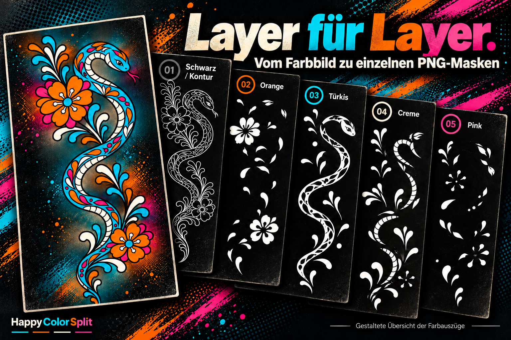

# HappyColorSplit

Windows-Desktop-Anwendung zum Trennen ähnlicher Farben aus PNG- und JPG-Bildern. Jede Farbgruppe wird als eigenes PNG exportiert. Standard ist **weiße Farbfläche auf schwarzem Hintergrund in Originalgröße**; Flächenfarbe und Hintergrund lassen sich unabhängig voneinander wählen. Der lokale Entwicklungsstand bietet zusätzlich eine proportionale Skalierung pro Bild.

Aktueller Entwicklungsstand: **0.1.0-preview.4**. Dies ist eine Vorabversion. Projekt und Quellcode sind im öffentlichen Repository [HappyProjectLab/HappyColorSplit](https://github.com/HappyProjectLab/HappyColorSplit) verfügbar.

## Programm herunterladen

### [⬇ HappyColorSplit für Windows herunterladen (ZIP, x64)](https://github.com/HappyProjectLab/HappyColorSplit/releases/download/v0.1.0-preview.4/HappyColorSplit-0.1.0-preview.4-Windows-x64.zip)

ZIP vollständig entpacken und im Ordner `HappyColorSplit` die Datei **HappyColorSplit.exe** starten. **Die .NET-Laufzeit ist enthalten; eine zusätzliche .NET-Installation ist nicht erforderlich.** Alle Dateien und Unterordner zusammen behalten.

Voraussetzung: Windows 10/11 mit x64-Prozessor. Dies ist eine Vorabversion. Der Download ist öffentlich zugänglich; ein GitHub-Konto ist dafür nicht erforderlich.

[Versionshinweise, Quellcode und SHA-256-Prüfsummen](https://github.com/HappyProjectLab/HappyColorSplit/releases/tag/v0.1.0-preview.4)

### Windows blockiert den Start? (Defender SmartScreen)

Nach dem Herunterladen und Entpacken kann Windows die EXE zunächst blockieren oder „Der Computer wurde durch Windows geschützt“ anzeigen. Eine SmartScreen-Warnung wegen einer unbekannten App ist allein noch kein Nachweis für Schadsoftware, aber auch keine Sicherheitsfreigabe.

Wenn du das ZIP aus dem oben verlinkten offiziellen Release geladen und die Herkunft geprüft hast, kannst du den Start gegebenenfalls ausdrücklich zulassen:

- Im SmartScreen-Fenster **Weitere Informationen → Trotzdem ausführen** wählen, sofern Windows diese Möglichkeit anbietet.
- Bei einer Dateiblockierung: Rechtsklick auf **HappyColorSplit.exe → Eigenschaften → Allgemein → Sicherheit → Zulassen**, falls vorhanden, dann **Übernehmen**. Anschließend erneut starten. Alternativ die heruntergeladene ZIP vor dem Entpacken auf dieselbe Weise zulassen und danach vollständig neu entpacken.

Bei einer konkreten Malware-Meldung oder einer administrativen Sperre diese Schritte nicht als Umgehung verwenden. Defender oder SmartScreen müssen für HappyColorSplit nicht generell deaktiviert werden. Weitere Hinweise stehen in der [Windows-Installationsanleitung](docs/WINDOWS_RELEASE.md#defender-smartscreen-und-dateiblockierung).

## Vom Motiv zu einzelnen Farbauszügen

### Vom Motiv zur Schablone



Aus der Vorbereitung meines Latex-Siebdruck-Projekts ist HappyColorSplit entstanden: ein kleines Werkzeug zum Trennen ähnlicher Farben.

### Farben erkennen und auswählen



Die echte Programmoberfläche zeigt das Ausgangsmotiv und die Vorschau eines Farbauszugs. Hier sind fünf Farbgruppen für den Export ausgewählt; die zusätzliche Übergangsfarbe bleibt abgewählt.

Die Abbildung zeigt einen früheren Oberflächenstand. Die aktuelle Version bietet zusätzlich die Auswahl von Flächenfarbe und Export-Hintergrund.

### Ein Motiv, fünf Farbauszüge



Die gestaltete Collage veranschaulicht die Aufteilung in Schwarz/Kontur, Orange, Türkis, Creme und Pink. In der Standardeinstellung wird jede ausgewählte Farbfläche weiß auf schwarzem Hintergrund gespeichert – als Ausgangspunkt für die weitere Schablonen-Aufbereitung. Flächenfarbe und Hintergrund sind auch anders wählbar.

Die fünf Farbauszüge gehören zu diesem Beispiel. Die Anzahl der Farbgruppen richtet sich nach dem Motiv und der gewählten Farbähnlichkeit.

## Lizenz

HappyColorSplit ist freie Software unter der **GNU General Public License, Version 3 oder einer späteren Version** (`GPL-3.0-or-later`). Der vollständige maßgebliche Lizenztext steht in [LICENSE](LICENSE) und wird bei jedem Build und jeder Publish-Ausgabe mitgeliefert.

Du darfst das Programm nach den Bedingungen dieser Lizenz verwenden, verändern und weitergeben. Bei einer Weitergabe sind insbesondere die Lizenzhinweise und die anwendbaren Pflichten zur Bereitstellung des zugehörigen Quellcodes zu beachten. Die Regelungen zu Gewährleistung und Haftung stehen im vollständigen Lizenztext.

Rechte an verwendeten Bilddateien richten sich weiterhin nach deren eigenen Bedingungen. Drittanbieter-Komponenten bleiben unter ihren jeweiligen Lizenzen; die Projektlizenz ersetzt deren Lizenztexte und Hinweise nicht.

HappyColorSplit is licensed under the **GNU General Public License, version 3 or later** (`GPL-3.0-or-later`). See [LICENSE](LICENSE) for the full terms. Third-party components remain subject to their own licenses.

Die mitgelieferten Komponenten und ihre Lizenztexte sind in der [deutschen Komponentenübersicht](docs/THIRD_PARTY_COMPONENTS_DE.md), der [englischen Übersicht](docs/THIRD_PARTY_COMPONENTS.md) und den [Drittanbieterhinweisen](licenses/THIRD_PARTY_NOTICES.md) dokumentiert. Der vollständige Ordner `licenses` wird zusammen mit der Projektlizenz und den Übersichten automatisch mitgeliefert.

Im Programm öffnet **Lizenzen & Hinweise** oben rechts einen eigenen Lesebereich. Dort sind die Projektlizenz, der Hinweis **Datensicherheit und Haftung**, die Komponentenübersicht und alle mitgelieferten Original-Lizenztexte auswählbar. Die Texte lassen sich markieren und kopieren. Bedienung, Nutzungshinweis und Komponentenübersicht folgen der ausgewählten Sprache; Original-Lizenztexte werden unverändert in ihrer jeweiligen Sprache angezeigt. Die Anzeige funktioniert ohne Internetverbindung.

## Hinweis zu Datensicherheit und Haftung

HappyColorSplit wird als kostenlose Open-Source-Software unter der GNU GPL Version 3 oder später bereitgestellt. Die Regelungen zu Gewährleistung und Haftung finden sich im mitgelieferten Lizenztext. Zwingende gesetzliche Rechte bleiben unberührt.

Trotz sorgfältiger Entwicklung können Fehler und unerwartete Auswirkungen auftreten, einschließlich fehlerhafter Ergebnisse, Dateibeschädigungen oder Datenverlust. Erstelle deshalb vor der Verwendung Sicherungskopien wichtiger Dateien, arbeite möglichst mit Kopien und überprüfe die exportierten Ergebnisse.

## Data safety and liability notice

HappyColorSplit is provided as free, open-source software under the GNU GPL version 3 or later. The terms concerning warranty and liability are set out in the accompanying license text. Mandatory statutory rights remain unaffected.

Despite careful development, errors and unexpected effects can occur, including incorrect results, file corruption, or data loss. Before using the program, back up important files, work with copies where possible, and check the exported results.

## Maintainer und Kontakt

Öffentlich sichtbarer Maintainer-Name: **HappyProjectLab**. HappyColorSplit ist ein kostenloses Open-Source-Hobbyprojekt.

Fragen, Fehlerberichte und Verbesserungsvorschläge bitte über [GitHub Issues](https://github.com/HappyProjectLab/HappyColorSplit/issues) einreichen. Dafür ist ein GitHub-Konto erforderlich. Issues sind öffentlich einsehbar; bitte keine Zugangsdaten, persönlichen Angaben oder vertraulichen Bilder einstellen. Sicherheitslücken gehören in den getrennten Meldeweg gemäß [SECURITY.md](SECURITY.md).

Public maintainer name: **HappyProjectLab**. Please use [GitHub Issues](https://github.com/HappyProjectLab/HappyColorSplit/issues) for general questions, bugs and suggestions. Issues are public and require a GitHub account to submit. Do not post sensitive data or vulnerability details; follow [SECURITY.md](SECURITY.md) for security reports.

## Mitwirken und Sicherheitsmeldungen

Die [Beitragsregeln](CONTRIBUTING.md) beschreiben Fehlerberichte, Entwicklung, Prüfungen und den Umgang mit Bildrechten und Abhängigkeiten. Für Sicherheitslücken gilt [SECURITY.md](SECURITY.md); dort ist auch der aktuelle Stand des vertraulichen Meldewegs beschrieben.

## Starten

Voraussetzung: .NET SDK 10.

```powershell
dotnet restore
dotnet build
dotnet run --project HappyColorSplit.csproj
```

## Verwendung

**Neu in 0.1.0-preview.4:** Drag-and-drop, optionale Windows-Einbindung, ein Button für den letzten Exportordner und getrennte Auswahlen für Flächenfarbe und Export-Hintergrund.

**Lokaler Entwicklungsstand:** Die nachfolgend beschriebene individuelle Bildskalierung, die gemeinsame Farberkennung mit strikter Farbauswahl pro Bild, der kombinierte Export und der Laser-Modus sind noch nicht im oben verlinkten Download `0.1.0-preview.4` enthalten.

Ein oder mehrere Bilder lassen sich auf das Programmfenster ziehen. Unterstützt werden `.png`, `.jpg` und `.jpeg`; andere Formate und beschädigte Dateien werden nicht geladen. Bei gemischter Auswahl werden gültige Bilder übernommen und Fehler angezeigt. Während einer Verarbeitung nimmt das Fenster keine weiteren Dateien entgegen.

Unter **Windows-Einbindung** lassen sich **Öffnen mit → HappyColorSplit** und **Senden an → HappyColorSplit** für das eigene Benutzerkonto einrichten und wieder entfernen. Das Standardprogramm für Bilder wird dabei nicht geändert; Administratorrechte sind nicht nötig. Details und die englische Anleitung: [Windows-Einbindung](docs/WINDOWS_INTEGRATION.md).

1. Ein oder mehrere PNG-/JPG-Bilder über **Bilder hinzufügen** auswählen (Strg/Shift im Dateidialog). Weitere Auswahlvorgänge ergänzen die Liste; dieselbe Datei wird nicht doppelt aufgenommen.
2. Farbähnlichkeit und **Mindestdeckkraft** einstellen und **Farben erkennen** wählen. Ein kleiner Ähnlichkeitswert trennt Farben feiner, ein großer Wert fasst mehr Farben zusammen. Bei 0 werden nur identische RGB-Farben zusammengefasst. Die Mindestdeckkraft ist standardmäßig 128/255 (etwa 50 %); schwächere Pixel werden ignoriert. 1 entspricht dem früheren Verhalten. JPG-Dateien sind deckend und werden vom Deckkraftfilter nicht verändert.
3. Farbgruppen in der Liste auswählen, um die Exportvorschau zu sehen. Die Häkchen bestimmen, welche Farben exportiert werden. **Alle** und **Keine** setzen die Auswahl gemeinsam. Ohne gewählte Farben ist der Einzelexport deaktiviert.
4. **Ausgewähltes Bild exportieren** wählen und einen Zielordner auswählen.

Für mehrere Bilder: **Farben erkennen** wertet alle geladenen Bilder mit der aktuellen Farbähnlichkeit und Mindestdeckkraft aus. Danach jedes Bild in der Importliste anklicken: Seine Farbgruppen und die zugehörigen Häkchen erscheinen automatisch. **Alle Bilder exportieren** speichert ausschließlich die angehakten Farbgruppen jedes Bildes. Im gemeinsamen Exportordner erhält jedes exportierte Bild einen eigenen Unterordner, auch bei identischen Dateinamen aus verschiedenen Quellordnern.

Die Mindestdeckkraft gilt für alle Bilder. Nach der ersten erfolgreichen Erkennung sind zunächst alle Farbgruppen des jeweiligen Bildes angehakt. Jede Datei behält ihre eigene Farbauswahl während der aktuellen Sitzung, auch nach einem Bildwechsel und erneuter Erkennung. Bilder ohne erfolgreiche Erkennung oder ohne angehakte Farben werden im Stapel ausdrücklich übersprungen, ohne auf alle Farben zurückzufallen. Solange kein Bild eine gewählte Exportfarbe hat, ist der Stapel-Export deaktiviert. Änderungen an Farbähnlichkeit oder Mindestdeckkraft verwerfen die Erkennung und setzen die Farbauswahl aller Bilder zurück. Die Farbauswahl bezieht sich auf die unveränderte Quelldatei; extern bearbeitete Bilder bitte neu laden und prüfen.

**Kombiniert exportieren** speichert genau eine PNG pro Bild aus allen dort angehakten Farbflächen. Die Flächen werden zuerst zu einer gemeinsamen Maske vereinigt, entsprechend schwarzen Flächen auf transparentem Hintergrund. Erst danach werden die gewählte Flächendarstellung, der Hintergrund und die individuelle Bildgröße angewendet. So übermalt der Hintergrund einer Ebene keine andere Ebene. Bei **Gruppenfarbe** behält jede ausgewählte Fläche ihre jeweilige Referenzfarbe. Abgewählte Gruppen und ignorierte Pixel gehören nicht zur gemeinsamen Maske.

Die Einstellung **Auswahl vereinen** in der Exportvorschau zeigt diese gemeinsame Maske mit den aktuellen Ausgabeoptionen. Änderungen an den Häkchen aktualisieren sie sofort. Neue Detailansichten einschließlich grüner Überlagerung können ebenfalls die gesamte Auswahl zeigen. Die Vorschau-Einstellung ändert nicht die Exportart: **Alle Bilder exportieren** erzeugt weiterhin einzelne Farb-PNGs; **Kombiniert exportieren** erzeugt Dateien mit der Endung `_merged.png`, jeweils in einem eigenen Bild-Unterordner. Beide Exportarten verwenden ausschließlich die gespeicherten Häkchen des jeweiligen Bildes und dessen eigene Größe und DPI.

**Detailansicht / Überlagerung** öffnet die ausgewählte Maske in Originalauflösung. Die Vergrößerung reicht von 25 bis 800 %. Scrollleisten verschieben den Ausschnitt. Bei aktiver Originalüberlagerung markiert eine grüne Fläche die ausgewählte Maske; die Überlagerungsstärke ist einstellbar. Ohne Überlagerung wird die Exportvorschau mit der gewählten Flächenfarbe und dem gewählten Hintergrund gezeigt. Die Detailansicht ist eine Momentaufnahme der aktuellen Auswahl.

Die Bildliste zeigt Miniaturvorschauen. Ein Klick auf ein Bild zeigt dessen Original; **Farben erkennen** erzeugt die zugehörigen Farbgruppen und Maskenvorschauen. Die Farbauswahl bereits geprüfter Bilder bleibt beim Bildwechsel erhalten. Mit **Entfernen** oder **Liste leeren** lassen sich Bilder aus der Liste nehmen.

Die Stapelverarbeitung lädt jeweils nur ein Bild in voller Auflösung. Fehlerhafte Dateien werden übersprungen und mit ihren Fehlerdetails angezeigt. Ein Abbruch behält bereits vollständig exportierte Bilder bei und entfernt den unvollständigen Export des gerade bearbeiteten Bildes. Die Abschlussmeldung nennt die Anzahl fertiger Bilder, PNGs, Fehler und den Zielordner.

Der Export erzeugt einen neuen Unterordner. Dateinamen enthalten laufende Nummer und RGB-Hexwert der Referenzfarbe. Vorhandene Exporte werden nicht überschrieben. Bei Abbruch werden die temporären Dateien des aktuellen Exports entfernt.

**Letzten Export öffnen** ist immer sichtbar und öffnet den zuletzt erfolgreich erstellten Export-Unterordner; beim Stapel-Export den gemeinsamen Stapelordner. Bis zum nächsten erfolgreichen Export bleibt dieses Ziel erhalten, auch nach einem Neustart. Ohne vorhandenen Ordner ist der Button ausgegraut. Der Zielordner für neue Exporte wird weiterhin separat ausgewählt.

### Eigene Bildgröße pro Import

Ein Bild in der Importliste auswählen und **Bildgröße** öffnen. Jedes Bild besitzt seine eigene Größe, Eingabe-Einheit und DPI-Zahl. Die Werte bleiben beim Bildwechsel innerhalb der Sitzung erhalten; beim Stapel-Export werden sie für jedes Bild einzeln angewendet. Neu importierte Bilder starten bei 100 %. Die Eingabemaske lässt sich durch einen Klick außerhalb schließen; Änderungen gelten sofort.

- **%:** Prozentuale Skalierung gegenüber der Originalpixelgröße eingeben. 200 % verdoppelt Breite und Höhe, 50 % halbiert sie. **100 %** setzt ausschließlich das ausgewählte Bild auf seine Originalpixelgröße zurück und behält dessen DPI bei.
- **cm:** Breite oder Höhe in Zentimetern eingeben. Die andere Seite wird automatisch angepasst; das Seitenverhältnis ist immer gesperrt. Maße beziehen sich auf die gesamte Bildfläche einschließlich vorhandener Ränder.
- **DPI:** Einstellbar von 1 bis 2400, zunächst 300. In cm bleibt beim Ändern der DPI die physische Größe erhalten; die Pixelzahl ändert sich. In % bleibt die Pixelzahl erhalten; die Zentimetergröße ändert sich. Eine geänderte DPI-Zahl wird als Vorgabe für weitere Importe gespeichert, verändert aber keine anderen bereits geladenen Bilder. DPI-Angaben der Quelldatei werden nicht automatisch übernommen.

Die Größenanzeige nennt Originalpixel, Exportpixel und die resultierenden Zentimetermaße. Zentimeter werden über `Pixel = cm / 2,54 × DPI` umgerechnet und auf ganze Pixel gerundet; kleine Rundungsabweichungen sind dadurch möglich. Die gewählte Auflösung wird im PNG als physische Pixeldichte gespeichert. Nachfolgende Programme müssen diese Angabe berücksichtigen; andernfalls dort DPI oder Maße beim Import entsprechend einstellen.

Die Farberkennung bleibt auf der Originalgröße. Erst die Ausgabe wird ohne Mischfarben proportional skaliert; beim Verkleinern können sehr feine Details verloren gehen. Vorschau und neue Detailansichten verwenden dieselbe Skalierung, die Vorschau passt sich weiterhin dem Fenster an. Pro Exportbild sind maximal 16 Millionen Pixel möglich. Ungültige Größeneingaben ersetzen den letzten gültigen Wert nicht. Die Originaldatei wird nicht verändert. Bildgrößen gelten für die aktuelle Importliste und werden nicht als Bildprojekt gespeichert.

**Flächen exportieren als** / **Export areas as** bietet **Schwarz**, **Weiß**, **Transparent** und **Gruppenfarbe**. Gruppenfarbe gibt die gesamte ausgewählte Fläche in der erkannten Referenzfarbe ihrer Gruppe aus. Transparent erzeugt stattdessen einen vollständig transparenten Ausschnitt an dieser Stelle. Ähnliche Farbtöne einer Gruppe erhalten dieselbe Referenzfarbe. Die Einstellung gilt für Einzel- und Stapel-Export, wird gespeichert und aktualisiert die Exportvorschau und neu geöffnete Detailansichten direkt. Die Farberkennung und die ausgewählten Exportgruppen bleiben dabei erhalten. Standard bleibt Weiß auf Schwarz. Vorhandene Einstellungen der bisherigen Farbexport-Checkbox werden übernommen.

**Export-Hintergrund** bietet **Schwarz**, **Grau** (`#808080`), **Weiß** oder **Transparent**. Die Einstellung gilt unabhängig von der Flächenauswahl für Vorschau, neue Detailansichten und beide Exportarten; sie wird gespeichert. Transparent bedeutet echte PNG-Transparenz außerhalb der ausgewählten Fläche. Ausgewählte Pixel sind bei Schwarz, Weiß und Gruppenfarbe vollständig deckend; die Flächeneinstellung Transparent setzt sie auf Alpha 0. Beide Auswahlmenüs stehen in getrennten Bereichen. Das Schachbrettraster in der Vorschau dient nur zur Anzeige und wird nicht mitgespeichert. Gleiche Flächen- und Hintergrundfarben sind möglich und können die Fläche unsichtbar machen; Transparent für beide Bereiche erzeugt ein vollständig transparentes PNG.

## Laser / Applikationen

Oben zwischen **Farbauszüge** und **Laser** wechseln. Der Laser-Arbeitsbereich nutzt die Fläche der bisherigen Original- und Exportvorschau; rechts erscheint eine Liste der angelegten Materialseiten.

Links und oberhalb der angeordneten Arbeitsfläche helfen Zentimetermaßstäbe mit ganzen und halben Zentimetern bei der Orientierung. Die Maßstäbe werden nicht exportiert.

Der reservierte Rand wird auf der Arbeitsfläche und an den Maßstäben grau angezeigt. Gefüllte Teile lassen sich nach dem Anordnen mit der Maus verschieben; **Bearbeiten** wählt Einzelteil oder Bereich. Rand und Abstände werden beim Loslassen geprüft. **Rückgängig** stellt die vorherige Position wieder her; Export und Vorschau übernehmen gültige Änderungen. Erneutes Anordnen ersetzt manuelle Änderungen.

1. Bilder laden, gegebenenfalls pro Bild **Bildgröße** einstellen und **Farben erkennen** ausführen. Im Bereich **Farbauszüge** pro Bild ausschließlich die auszuschneidenden Farbgruppen anhaken; eine unerwünschte Hintergrundgruppe abwählen.
2. In **Laser → Laser-Einstellungen** die Arbeitsfläche in Zentimetern und die PNG-Auflösung festlegen. Standard: 30 × 20 cm bei 300 DPI.
3. Vorhandene Materialien mit optionalem Namen und einer Farbe als `#RRGGBB` zur Liste hinzufügen. Die ausgewählten Bildfarben werden automatisch der ähnlichsten Materialfarbe zugeordnet.
4. **Anordnen** erstellt die Seiten. Zusammenhängende Materialflächen bilden Teile; nahe Teile werden Bereichen zugeordnet. Die Anordnung hält Quelldateien als Gruppen zusammen, übernimmt die individuellen Bildmaße und dreht ausschließlich in Vierteldrehungen. Kleine Teile können freie Aussparungen größerer Teile derselben Quelldatei nutzen; ihre ursprüngliche Bereichszuordnung bleibt erhalten. Die Mindestabstände zum Plattenrand, beim Einsetzen in Aussparungen und zwischen anderen Teilen sind unabhängig einstellbar (zunächst 0 / 0,5 / 0,5 cm). Spiegelungen und Überlappungen sind ausgeschlossen.
5. Jede Materialfarbe erhält eigene Seiten. Reicht eine Seite nicht aus, werden weitere angelegt. Seiten rechts anklicken. **Dateien und Bereiche** zeigt die Zuordnung; **Gruppenrahmen anzeigen** blendet Vorschau-Markierungen ein, die nicht exportiert werden.
6. **Seite exportieren**, **Alle Seiten exportieren** oder **Kombiniert exportieren** speichert die platzierten Teile mit den üblichen Einstellungen für Flächenfarbe und Hintergrund. Bei Gruppenfarbe wird die zugeordnete Materialfarbe verwendet. Jede Seite ist bereits einfarbig nach Material; der kombinierte Export speichert ihre gemeinsame Maske mit `_merged.png`.

Nach Änderungen an Auswahl, Bildgröße, Materialien oder Arbeitsfläche muss erneut angeordnet werden; veraltete Seiten sind für den Export gesperrt. Die Anordnung verwendet eine Rechteck-Packheuristik mit Gruppierung, keine Garantie auf die weltweit dichteste Belegung. Zu große zusammenhängende Teile werden gemeldet und nicht verkleinert, zerschnitten oder entfernt. Details zu Gruppierung, Abständen und Ausgabe: [Laser-Arbeitsbereich](docs/LASER_WORKSPACE.md).

Auf die erste Anordnung folgt automatisch ein zweiter Optimierungslauf. Jede Materialfarbe behält das bessere Ergebnis: weniger Seiten oder bei gleicher Seitenzahl weniger belegte Begrenzungsfläche. Abstände, Bildmaße und Gruppierung bleiben erhalten.

## Farbverarbeitung

Die häufigste noch nicht zugeordnete RGB-Farbe dient als feste Referenzfarbe einer Gruppe. Farben werden anhand ihres euklidischen Abstands im RGB-Farbraum der nächstgelegenen passenden Referenz zugeordnet. Der Regler gibt den maximalen Abstand zur Referenz an (0–150). Es handelt sich um eine einfache RGB-Gruppierung, nicht um eine wahrnehmungsbasierte Farbraumanalyse. Auch die Hintergrundfarbe erhält eine eigene Gruppe.

Vollständig transparente Pixel und Pixel unterhalb der Mindestdeckkraft gehören keiner Gruppe an und verwenden den gewählten Export-Hintergrund. Übrige Pixel werden anhand ihres gespeicherten RGB-Werts zugeordnet und entsprechend der Flächenauswahl schwarz, weiß, transparent oder in der Referenzfarbe ihrer Gruppe ausgegeben. Abgewählte Farbgruppen werden nicht gespeichert; ihre Pixel verwenden in allen anderen Masken den gewählten Hintergrund und werden keiner anderen Farbe zugewiesen. Diese Version führt keine automatische Konturreparatur oder Entfernung kleiner zusammenhängender Flächen durch. EXIF-Ausrichtung wird vor der Verarbeitung angewendet. Bei animierten PNGs wird nur das erste Bild verwendet.

Grenzen: maximal 16 Millionen Pixel je Eingabebild und je skaliertem Exportbild sowie 256 Farbgruppen. Bei zu vielen Gruppen die Farbähnlichkeit erhöhen. Große JPGs, starke Skalierung und viele Gruppen können Zeit und Arbeitsspeicher benötigen; Verarbeitung und Export laufen außerhalb der Oberfläche und können abgebrochen werden.

## Technik und Struktur

- C#, .NET 10, Avalonia 12.1.1 mit AXAML, dunkles Fluent-Theme und Inter.
- `Views`: Fenster; `ViewModels`: Zustand und Befehle; `Models`: Daten; `Services`: Bildverarbeitung, Dateiauswahl, Einstellungen und Übersetzungen; `Controls`: wiederverwendbare Farbkachel; `Assets`: Programmsymbol.
- Zentral verwaltete deutsche und englische Texte in `Services/Texts.cs`.
- Einstellungen: `%LOCALAPPDATA%\HappyColorSplit\settings.json` (Sprache, Farbähnlichkeit, Mindestdeckkraft, Flächenfarbe, Export-Hintergrund, letzter erfolgreicher Exportordner sowie Größen-Einheit und DPI-Vorgabe für neue Bilder).
- Wenn noch keine neuen Einstellungen vorliegen, werden die Einstellungen der bisherigen Anwendung eingelesen. Beim Speichern werden sie im neuen Benutzerdatenordner abgelegt; die bisherige Datei bleibt erhalten.
- NuGet: Avalonia 12.1.1 und SkiaSharp 3.119.4 für Bilddecodierung, Vorschau und PNG-Export. Bildverarbeitung und Avalonia-Rendering verwenden dieselbe SkiaSharp-Version. Details: [Bildverarbeitung](docs/IMAGE_PROCESSING.md).

## Windows-Paket

```powershell
dotnet publish HappyColorSplit.csproj -p:PublishProfile=Windows -o artifacts/HappyColorSplit-Windows
pwsh -NoProfile -File tools/ValidateThirdPartyCompliance.ps1 -PublishDirectory artifacts/HappyColorSplit-Windows
```

Der Ausgabeordner enthält `HappyColorSplit.exe`, die verwendeten Bibliotheken, die integrierte .NET-Laufzeit **10.0.12** und die Lizenzunterlagen. Das geprüfte Paket ist für Windows x64; eine separat installierte .NET-Laufzeit wird nicht benötigt. Änderungen an der Laufzeit oder Zielplattform benötigen eine neue Komponenten- und Lizenzinventur.

Für ein vollständiges Release nach dem Commit ausführen:

```powershell
pwsh -NoProfile -File tools/New-WindowsRelease.ps1
```

Das Skript benötigt einen sauberen Git-Stand und erzeugt unter `artifacts/releases` das Windows-ZIP, ein Quellcode-ZIP desselben Commits und SHA-256-Prüfsummen. Es prüft das Programmpaket und sämtliche Dateien im fertigen ZIP. Vorhandene Release-Dateien werden nicht überschrieben. Das Erstellen der Dateien allein lädt sie noch nicht auf GitHub hoch.

## Funktionsprüfung

```powershell
dotnet run --project Tests/HappyColorSplit.Tests.csproj
```

Die Prüfung verwendet synthetische Bilder und kontrolliert die tatsächlichen Exportpixel, Farbgruppierung, Transparenz, Abbruch, Grenzen, JSON-Einstellungen und den Ablauf der Oberfläche ohne sichtbares Fenster. Sie prüft außerdem Mehrfachauswahl, Bildwechsel, das Entfernen und Leeren der Liste sowie Stapel-Exporte mit gleichen Dateinamen, beschädigten Dateien und Abbruch nach einem fertig exportierten Bild.

Zusätzliche Prüfungen kontrollieren Deckkraft-Grenzwerte, Farbauswahl, Exportfortschritt, transparente Überlagerung, Zoom und die Auswahl pro Bild im Stapel-Export. Optionale lokale Bildvergleiche ergänzen die synthetischen Prüfungen; die dafür verwendeten Bilddateien gehören nicht zum Repository.

Die Decoder-Prüfungen umfassen außerdem alle acht EXIF-Ausrichtungen bei JPEG, den ersten Frame eines animierten PNG, exakte RGB-Erhaltung bei geringer Deckkraft und das 8-Bit-Graustufenformat der Exportmasken. Optionale lokale Referenzwerte lassen sich mit `--capture-baseline` erfassen und mit `--verify-baseline` vergleichen; die Bilder und Referenzdatei werden nicht ins Repository aufgenommen.
